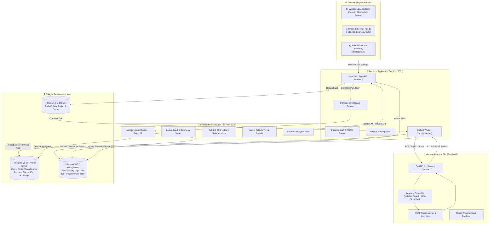

<p align="center">
  
</p>

<h1 align="center">🛡️ CyberShield AI — Enterprise Cyber Threat Intelligence Platform</h1>

<p align="center">
  <strong>Next-Generation AI-Driven Anomaly Detection, Predictive Attack Forecasting, Geospatial Spatial Threat Intelligence & Automated SOC Operations</strong>
</p>

<p align="center">
  
  
  
  
  
  
  
  
  
  
  
  
</p>

<p align="center">
  <a href="#-executive-summary">Overview</a> •
  <a href="#-system-architecture">Architecture</a> •
  <a href="#-key-platform-modules">Modules</a> •
  <a href="#-ai--machine-learning-engine">AI/ML Engine</a> •
  <a href="#-native-windows-log-collector">Endpoint Telemetry</a> •
  <a href="#-quick-start--one-click-run">Quick Start</a> •
  <a href="#-rest-api-reference">API Reference</a> •
  <a href="#-project-structure">Structure</a>
</p>

---

## 📋 Executive Summary

Modern Security Operations Centers (SOCs) face an existential challenge: enterprise infrastructures emit millions of heterogeneous network events, firewall logs, and authentication records daily. Traditional Security Information and Event Management (SIEM) systems rely on rigid, rule-based static signatures that produce overwhelming false positives while missing zero-day exploits, multi-stage kill chains, and subtle lateral movements.

**CyberShield AI** is an enterprise-grade, polyglot microservices cybersecurity platform designed to autonomously ingest, correlate, and triage security telemetry at scale. Built with a decoupled 3-tier microservice architecture, it combines unsupervised machine learning ensembles, Explainable AI (SHAP), predictive heuristic attack forecasting, geospatial ballistic threat visualization, and automated compliance reporting into a unified, dark glassmorphic SOC command center.

### Core Value Propositions
* ⚡ **Sub-Second Ingestion & Asynchronous Triage:** Redis and BullMQ process polymorphic logs without blocking client ingestion pipelines ($<20\text{ms}$ API response).
* 🧠 **Unsupervised ML Anomaly Ensemble:** Dual-model detection via Isolation Forest (200 trees) + One-Class Support Vector Machine (OCSVM) with RBF kernel.
* 🔍 **Explainable AI (XAI):** Transparent, human-interpretable feature attribution powered by SHAP (`TreeExplainer`) to eliminate black-box decision barriers.
* 🔮 **Predictive Attack Forecasting:** Multi-scenario sliding-window analysis projecting attack trajectories (DDoS, Credential Stuffing, Lateral Movement, Data Exfiltration) before full compromise occurs.
* 🌍 **Geospatial Spatial Intelligence:** Real-time Leaflet canvas rendering attack origins with animated ballistic trajectory arcs connecting adversary coordinates to target assets.
* 📄 **Automated Executive & Forensic Reporting:** On-demand compilation of cross-database telemetry into high-fidelity PDF briefs (via PDFKit) and structured CSV audit sheets.
* 🪟 **Native Windows Endpoint Agent:** Standalone Python agent collecting Windows Security (Event IDs 4624, 4625, 4688, etc.), Defender, and System logs with zero external dependencies.

---

## 🏗️ System Architecture

CyberShield AI leverages a **Polyglot Persistence Microservices Topology** where high-frequency, unstructured telemetry ingestion is isolated from ACID-compliant relational states and analytical machine learning workloads.



### Decoupled Polyglot Data Strategy

| Database Engine | ORM / Driver | Data Responsibility | Architectural Rationale |
|---|---|---|---|
| **PostgreSQL 16** | Prisma ORM `v6.19.3` | `User`, `Alert`, `ThreatScore`, `BlockedIP`, `AuditLog`, `Report`, `NotificationSetting`, `PlatformSetting` | Enforces ACID guarantees, relational integrity, strict enum validation, and transactional foreign keys for critical compliance records. |
| **MongoDB 7.0** | Mongoose `v9.7.1` | `securitylogs` collection (raw payloads, IP headers, geo-coordinates, ML anomaly outputs) | High-throughput document lake accommodating heterogeneous, schema-less event streams with variable attributes without migration friction. |
| **Redis 7.0** | ioredis `v5.11` | BullMQ task queue, distributed rate-limiting state, fast cache | Sub-millisecond queue broker decoupling user-facing HTTP ingestion from intensive ML inference pipelines. |

---

## ✨ Key Platform Modules

### 1. 📊 Real-Time SOC Command Center (`/overview`)
* **Live KPI Telemetry:** 6 real-time stat cards tracking Total Ingested Logs, Active Threat Alerts, Critical Incidents, High-Risk User Entities, Blocked Malicious IPs, and Mean Platform Threat Score.
* **Temporal Trend Analysis:** Interactive 30-day Threat Volume area charts rendered via Recharts.
* **Threat Distribution:** Severity donut chart (Critical, High, Medium, Low), attack vector stacked bars, and top offending IP ranking.
* **Live Activity Feed:** Chronological, color-coded stream of real-time security events and automated system actions.

### 2. 📋 Security Log Explorer & Bulk Telemetry Ingestion (`/logs`)
* **Multi-Dimensional Filtration:** Filter by Severity, Ingestion Source (Firewall, IDS, Antivirus, Endpoint), Protocol (TCP, UDP, SSH, HTTPS), Action (Allow, Deny, Block), Country, and temporal date ranges.
* **Sub-String Global Search:** Real-time debounced query search across IP addresses, hostnames, and message payloads.
* **Deep Inspection Drawer:** Slide-in modal displaying full normalized metadata, geographical coordinates, risk weightings, and syntax-highlighted raw JSON payloads.
* **Bulk Upload Dialog:** Drag-and-drop ingestion interface supporting CSV and JSON batches directly into `/api/logs/bulk` with client-side syntax validation.

### 3. 🚨 AI-Powered Incident Response & Alert Triage (`/alerts`)
* **Automated Threshold Triggering:** Background workers automatically promote any event with $\text{ThreatScore} \ge 60$ into a formal PostgreSQL `Alert`.
* **Stateful Incident Lifecycle:** Transition alerts seamlessly across `NEW` $\to$ `INVESTIGATING` $\to$ `RESOLVED` / `FALSE_POSITIVE` with optimistic UI updates.
* **SHAP Explainability Cards:** Every alert unpacks the exact AI reasoning factors (e.g., *Elevated country risk index*, *Repeated failed login sequence*, *Abnormal port communication*).
* **Analyst Assignment:** Workflow controls allowing senior analysts to delegate incident investigations to active SOC operators.

### 4. 🎯 Entity Threat Profiling (`/threats`)
* **Actor-Centric Profiling:** Dedicated risk cards for suspicious IP addresses, compromised user accounts, and anomalous sessions.
* **5-Factor Multi-Vector Breakdown:** Visual progress gauges decomposing risk across **Anomaly Detection (35%)**, **Login Failures (20%)**, **Country Risk (15%)**, **Port Vulnerability (15%)**, and **Severity Weight (15%)**.
* **Temporal Score History:** Interactive trendlines mapping entity risk evolution over historical observation windows.

### 5. 🌍 Geospatial Threat Intelligence Map (`/geo-map`)
* **Interactive Leaflet/React-Leaflet Canvas:** World map plotting real-time attack origins from embedded geolocation telemetry (`latitude`, `longitude`, `country`).
* **Dynamic Ballistic Missile Arcs:** Animated visual flight paths tracing attacks from adversary origins directly to defended enterprise assets.
* **Severity-Coded Markers:** Pulsing neon radar pins distinguishing Critical, High, Medium, and Low severity incursions.
* **Origin Drilldown Feed:** Country threat rankings, attack velocity counters, and active threat feed side panel (`GeoSidePanel`).

### 6. 🔮 Predictive Attack Forecasting Engine (`/predictions`)
* **8 Attack Scenario Projections:** Forecasts Brute Force escalation, Credential Stuffing, Distributed Denial of Service (DDoS), Port Scanning reconnaissance, Data Exfiltration, Account Takeover, Lateral Movement, and Insider Threats.
* **Confidence & Time-Horizon Metrics:** Radial probability gauges and time-to-impact countdown timers.
* **MITRE ATT&CK Countermeasure Checklists:** Actionable remediation playbooks for SOC analysts with one-click mitigation acknowledgement.
* **Interactive Threat Simulation Presets:** Test incident scenarios in sandbox mode using pre-configured attack vectors (e.g., *Active DDoS Wave*, *Brute Force Storm*, *Lateral Movement Breach*).

### 7. 📄 Automated Security Reports & Compliance Engine (`/reports`)
* **Cross-Database Telemetry Compilation:** Merges MongoDB raw telemetry with PostgreSQL incident, entity, and blocklist states.
* **Multi-Format Export Engine:** Generates pixel-perfect executive PDF briefs (via PDFKit) and structured CSV spreadsheets.
* **Slide-In Report Reader Drawer:** Interactive executive dashboard displaying report summaries, severity breakdowns, offending source IPs, target destination ports, and remediation checklists.
* **Authenticated Streaming Downloads:** Secure, one-click binary file streaming protected with JWT authorization.

### 8. 👥 User Administration & Role-Based Access Control (`/users`)
* **Enterprise RBAC:** Granular role enforcement separating **`ADMIN`** (Full access, user administration, system settings), **`ANALYST`** (Incident investigation, log management, alert resolution), and **`VIEWER`** (Read-only monitoring).
* **User Management Console:** Admin-exclusive modal for user creation, credential resets, role reassignment, and instantaneous account deactivation.

### 9. ⚙️ Platform Configuration & Settings (`/settings`)
* **Profile & Authentication Management:** Personal profile details, password updates, and session security tracking.
* **Dynamic Platform Controls:** Adjustable threshold sliders for alert generation (e.g., tuning the default $\ge 60$ score trigger), default query limits, and log retention policies.
* **Notification Preferences:** Configuration panel for in-app alert banners, critical threat triggers, and webhook endpoints.

---

## 🧠 AI / Machine Learning Engine

CyberShield AI's analytical core is hosted in a dedicated Python FastAPI microservice (`ml-service`), implementing unsupervised anomaly detection, composite threat scoring, and explainable artificial intelligence.

```
Incoming Security Log Telemetry
              │
              ▼
8-Dimensional Feature Extraction Matrix
  [hour, is_login_failure, protocol_risk, source_weight, 
   country_risk, severity_level, port_risk, action_type]
              │
              ▼
   StandardScaler Normalization
              │
      ┌───────┴───────┐
      ▼               ▼
Isolation Forest    One-Class SVM
  (200 Trees)     (RBF Kernel, nu=0.05)
      └───────┬───────┘
              ▼
Fused Anomaly Score Normalized to [0.0, 1.0]
              │
              ▼
Weighted Threat Scoring Engine (0 to 100)
              │
              ▼
SHAP TreeExplainer & Human-Readable XAI Rationale
```

### 1. 8-Dimensional Feature Extraction Matrix
Raw telemetry is mapped into an 8-dimensional normalized continuous vector:
1. `hour` $(0 \text{ to } 23)$: Diurnal temporal pattern indicator.
2. `is_login_failure` $(0 \text{ or } 1)$: Authentication failure flag.
3. `protocol_risk` $(0.1 \text{ to } 0.8)$: Inherent protocol risk index (e.g., Telnet/SSH vs. HTTPS).
4. `source_weight` $(0.3 \text{ to } 0.8)$: Origin reliability weight (Firewall, IDS, Antivirus, Endpoint).
5. `country_risk` $(0.1 \text{ to } 1.0)$: Geopolitical threat correlation coefficient.
6. `severity_level` $(1 \text{ to } 4)$: Log severity weight (Low $= 1$, Critical $= 4$).
7. `port_risk` $(0.1 \text{ to } 0.9)$: Port vulnerability index (e.g., ports 22, 445, 3389).
8. `action_type` $(0.0 \text{ to } 0.9)$: Execution verdict (Allow $= 0.0$, Drop $= 0.5$, Block $= 0.9$).

### 2. Dual-Model Anomaly Ensemble
* **Isolation Forest:** Builds 200 isolation trees with a contamination factor of $0.05$. Calculates path lengths required to isolate points; outliers require significantly fewer splits.
* **One-Class Support Vector Machine (OCSVM):** Fits a non-linear hyper-boundary around nominal traffic patterns using a Radial Basis Function (RBF) kernel ($\nu = 0.05$).
* **Ensemble Fusion:** Combines decision margins into a continuous anomaly score $A_{\text{score}} \in [0.0, 1.0]$.

### 3. Composite Weighted Threat Scoring Formula
The platform computes an absolute threat score between $0$ and $100$ using the following weighted linear formulation:

$$\text{ThreatScore} = \text{round}\Big(35 \cdot A_{\text{score}} + 20 \cdot L_{\text{fail}} + 15 \cdot C_{\text{risk}} + 15 \cdot P_{\text{risk}} + 15 \cdot S_{\text{factor}}\Big) \in [0, 100]$$

| Parameter | Weight | Description |
|---|---|---|
| $A_{\text{score}}$ | **35%** | Fused Anomaly Score from ML Ensemble $[0.0, 1.0]$ |
| $L_{\text{fail}}$ | **20%** | Binary Failed Authentication Flag $(0 \text{ or } 1)$ |
| $C_{\text{risk}}$ | **15%** | Normalized Geopolitical Origin Risk $[0.0, 1.0]$ |
| $P_{\text{risk}}$ | **15%** | Normalized Destination Port Threat Index $[0.0, 1.0]$ |
| $S_{\text{factor}}$ | **15%** | Inherent Event Severity Factor $[0.0, 1.0]$ |

#### Risk Stratification Categories
* `CRITICAL` $(80 - 100)$: Severe active threat; immediate isolation & automated alert.
* `HIGH_RISK` $(60 - 79)$: High probability anomaly; automated alert creation.
* `MEDIUM_RISK` $(40 - 59)$: Suspicious activity; queued for analyst triage.
* `LOW_RISK` $(20 - 39)$: Low priority nominal variation.
* `SAFE` $(0 - 19)$: Verified benign traffic.

### 4. Explainable AI (XAI) with SHAP
Rather than presenting opaque numerical scores, the microservice employs **SHAP (SHapley Additive exPlanations)** `TreeExplainer` on the Isolation Forest model. For each scored event, the microservice evaluates local feature attribution, extracts the top contributing risk drivers, and translates them into plain-English analyst rationales (backed by a deterministic heuristic fallback if models are re-initializing).

---

## 🪟 Native Windows Log Collector

CyberShield AI includes an endpoint security collector (`tools/windows-log-collector`) engineered to collect live events from host Windows machines without third-party agent overhead.

```
Windows Event Log Subsystem (wevtutil / PowerShell XML)
        │
        ├── Security Channel (Event IDs 4624, 4625, 4648, 4688, 4720) [Admin Mode]
        ├── Windows Defender Channel (Event IDs 1116, 1117, 5007)      [User Mode]
        └── System Channel (Event IDs 7045, 10016)                     [User Mode]
        │
        ▼
Event Normalizer Engine (Normalizes to CyberShield SecurityLog Schema)
        │
        ▼
Watermark State Controller (.collector_state.json prevents duplicate uploads)
        │
        ▼
JWT Authenticated Ingestion Client (POST /api/logs/bulk)
```

### Agent Capabilities:
* **Zero External Dependencies:** Implemented exclusively in pure Python 3 using standard libraries (`urllib`, `xml.etree`, `subprocess`, `json`, `ctypes`). No `pip install` required.
* **Adaptive Elevation Detection:**
  * *Elevated (Administrator):* Collects critical Windows `Security` channel events including successful/failed logins (4624/4625), process creations (4688), user creations (4720), and privilege escalations (4672).
  * *Standard User:* Gracefully falls back to collecting antivirus and operational telemetry from `Microsoft-Windows-Windows Defender/Operational` and `System` channels.
* **Deduplication State:** Persists event high-watermark records in `.collector_state.json` to prevent duplicate ingestion across reboots.

#### Running the Collector:
```powershell
# Dry-run mode: Validate event normalization locally
python tools/windows-log-collector/collector.py --dry-run

# Live ingestion mode: Authenticate and stream events to NestJS
python tools/windows-log-collector/collector.py --interval 10
```

---

## 🚀 Quick Start & One-Click Run

### System Prerequisites
* **Operating System:** Windows 10/11, macOS, or Linux
* **Docker Desktop:** Installed and operational (WSL2 engine on Windows)
* **Node.js:** v18.x or v20.x (with npm v9+)
* **Python:** v3.10 or v3.11 (with pip)

---

### Option 1: One-Click Startup (Windows Automated)

The repository provides a single-command master startup batch script that automatically coordinates container initialization, health checks, database readiness, backend server boot, frontend compiler, and browser launch.

```cmd
# Simply double-click start.bat in the root folder, or execute:
.\start.bat
```

#### What happens behind the scenes:
1. Verifies Docker daemon status (starts Docker Desktop if inactive).
2. Executes `docker compose up -d` for PostgreSQL, MongoDB, Redis, Mongo Express, and the ML Service.
3. Polls native health check probes (`pg_isready`, `mongosh ping`, `redis-cli ping`, and ML `/health`).
4. Spawns the NestJS backend in a dedicated window on port `3001` and waits for HTTP `200 OK`.
5. Spawns the Next.js frontend in a dedicated window on port `3000`.
6. Launches your default web browser directly to `http://localhost:3000`.

*To monitor system services or perform a clean shutdown:*
```cmd
.\status.bat   # Check live container and port health
.\stop.bat     # Terminate all processes and docker containers cleanly
```

---

### Option 2: Manual Multi-Terminal Startup

#### 1. Clone & Configure Environment
```bash
git clone https://github.com/YashRaj7256/CyberShield-AI.git
cd CyberShield-AI

# The root .env file is pre-configured with default development secrets
```

#### 2. Start Infrastructure Containers
```bash
docker compose up -d
docker compose ps
```

#### 3. Initialize & Start Backend (NestJS)
```bash
cd backend
npm install
npx prisma generate
npx prisma migrate dev --name init

# Seed database with 10,000 realistic logs, 150 alerts, and demo accounts
npx ts-node prisma/seed.ts

# Start backend in development mode
npm run start:dev
```
*Backend API operational at `http://localhost:3001/api`*

#### 4. Start Machine Learning Service (FastAPI)
```bash
cd ../ml-service
pip install -r requirements.txt
uvicorn app.main:app --reload --port 8000
```
*ML Service operational at `http://localhost:8000` (Interactive docs: `http://localhost:8000/docs`)*

#### 5. Start Frontend Application (Next.js)
```bash
cd ../frontend
npm install
npm run dev
```
*SOC Dashboard operational at `http://localhost:3000`*

---

## 🔑 Pre-Configured Demo Credentials

The database seeder automatically initializes three role-tiered user accounts:

| Role | Email Address | Password | Permissions & Access Scope |
|---|---|---|---|
| **`ADMIN`** | `admin@cti.com` | `Admin@123` | **Full Platform Access:** User administration, settings configuration, report exports, alert triage, log querying. |
| **`ANALYST`** | `analyst@cti.com` | `Analyst@123` | **Operational Access:** Alert investigation & status lifecycle management, threat entity analysis, log filtering. |
| **`VIEWER`** | `viewer@cti.com` | `Viewer@123` | **Read-Only Access:** SOC overview dashboard, threat trends, read-only telemetry exploration. |

---

## 📡 REST API Reference

All backend REST endpoints are prefixed with `/api` and return standardized JSON envelopes:

```json
{
  "success": true,
  "data": { ... },
  "timestamp": "2026-10-26T12:00:00.000Z"
}
```

### 1. Authentication (`/api/auth`)
* `POST /api/auth/register` — Register a new account.
* `POST /api/auth/login` — Authenticate credentials; returns access & refresh JWTs.
* `POST /api/auth/refresh` — Issue a new 15-minute access token using a valid refresh token.
* `POST /api/auth/logout` — Revoke active session tokens.
* `GET  /api/auth/me` — Retrieve active user profile and role privileges.

### 2. Security Logs (`/api/logs`) 🔒
* `GET  /api/logs` — Query logs with multi-dimensional filtering (`severity`, `source`, `country`, `search`, `page`, `limit`).
* `GET  /api/logs/stats` — Aggregate metrics (total logs, severity distribution, top source IPs).
* `GET  /api/logs/:id` — Fetch complete log record including raw payload.
* `POST /api/logs` — Ingest a single log event (synchronous MongoDB write + BullMQ dispatch).
* `POST /api/logs/bulk` — Ingest a batch of log records ($<500$ events per batch).

### 3. Threat Alerts (`/api/alerts`) 🔒
* `GET   /api/alerts` — Retrieve alerts with severity, status, and search filters.
* `GET   /api/alerts/stats` — Aggregated counts by status and severity.
* `GET   /api/alerts/:id` — Retrieve alert record with SHAP explanation factors.
* `PATCH /api/alerts/:id` — Update alert status (`NEW`, `INVESTIGATING`, `RESOLVED`, `FALSE_POSITIVE`) or assign analyst.

### 4. Threat Entity Analysis (`/api/threats`) 🔒
* `GET /api/threats` — List threat entities (IPs, users, sessions) with composite scores.
* `GET /api/threats/:entityType/:entityValue` — Detailed factor breakdown and temporal risk history.

### 5. Attack Predictions (`/api/predictions`) 🔒
* `POST /api/predictions/forecast` — Run sliding-window attack forecasting over database telemetry.
* `POST /api/predictions/simulate` — Execute sandbox attack simulation presets.

### 6. Security Reports (`/api/reports`) 🔒
* `GET  /api/reports` — List generated reports and compliance archives.
* `GET  /api/reports/preview` — Pre-compute telemetry statistics before generating report.
* `POST /api/reports/generate` — Generate a new PDF or CSV report.
* `GET  /api/reports/:id/download` — Authenticated streaming download of compiled PDF or CSV.

### 7. Overview Dashboard (`/api/dashboard`) 🔒
* `GET /api/dashboard/stats` — Real-time overview metrics and counters.
* `GET /api/dashboard/threat-trends` — 30-day temporal threat volume timeseries.
* `GET /api/dashboard/attack-frequency` — Distribution across attack classification categories.
* `GET /api/dashboard/severity-distribution` — Proportionate counts across severity levels.
* `GET /api/dashboard/top-sources` — Top 10 offending external IP origins.

### 8. User Administration (`/api/users`) 🔒 *(Admin Only)*
* `GET    /api/users` — List platform users with activity timestamps.
* `POST   /api/users` — Provision new user account.
* `PATCH  /api/users/:id` — Modify user details or reassign role (`ADMIN`, `ANALYST`, `VIEWER`).
* `DELETE /api/users/:id` — Deactivate user account.

### 9. Platform Settings (`/api/settings`) 🔒
* `GET   /api/settings` — Fetch system configurations and threshold parameters.
* `PATCH /api/settings` — Update platform trigger thresholds and retention policies.

---

## 📁 Project Structure

```
CyberShield-AI/
├── 📄 docker-compose.yml          # Container orchestration (5 microservices)
├── 📄 .env                        # Centralized environment configuration
├── 📄 package.json                # Monorepo root workspace scripts
├── 📄 start.bat                   # 1-Click Windows master startup launcher
├── 📄 stop.bat                    # 1-Click Windows clean shutdown script
├── 📄 status.bat                  # 1-Click Windows health verification script
├── 📄 STARTUP_GUIDE.md            # Windows startup & operation guide
├── 📄 README.md                   # Platform documentation master file
│
├── 📁 docs/                       # Platform & academic documentation
│   ├── PROJECT_PHASE_REPORT.md    # Detailed phase-by-phase architectural master
│   ├── ML_AUDIT_AND_ARCHITECTURE_REPORT.md # ML models & classification audit
│   └── CYBERSHIELD_AI_FACULTY_GUIDE.md     # Academic project & faculty defense guide
│
├── 🔧 backend/                    # NestJS 11 REST API & Ingestion Gateway (Port 3001)
│   ├── prisma/
│   │   ├── schema.prisma          # 8 PostgreSQL models (User, Alert, ThreatScore, etc.)
│   │   └── seed.ts                # Database seeder (10,000 logs, 150 alerts, 3 users)
│   └── src/
│       ├── main.ts                # Application bootstrap (CORS, ValidationPipe, Swagger)
│       ├── app.module.ts          # Core root module configuration
│       ├── auth/                  # 🔐 JWT authentication & Passport strategies
│       ├── users/                 # 👥 User administration & RBAC CRUD
│       ├── logs/                  # 📋 Telemetry ingestion, search, & MongoDB schemas
│       ├── alerts/                # 🚨 Alert lifecycle & investigation workflows
│       ├── threats/               # 🎯 Entity risk profiling & factor decomposition
│       ├── predictions/           # 🔮 Attack prediction gateway to ML service
│       ├── reports/               # 📄 Automated PDF (PDFKit) & CSV report generators
│       ├── settings/              # ⚙️ Platform & notification configurations
│       ├── dashboard/             # 📊 Aggregated SOC analytics endpoints
│       ├── jobs/                  # ⚡ BullMQ background workers & ML queue processors
│       ├── prisma/                # 🗄️ PrismaClient lifecycle provider
│       └── common/                # 🛠️ Guards, decorators, filters, & interceptors
│
├── 🎨 frontend/                   # Next.js 16 + React 19 SOC Command Center (Port 3000)
│   └── src/
│       ├── app/
│       │   ├── (auth)/            # Glassmorphic Login & Registration pages
│       │   ├── (dashboard)/       # Authenticated SOC dashboard routes
│       │   │   ├── overview/      # 📊 Main SOC executive metrics & chart analytics
│       │   │   ├── logs/          # 📋 Security log explorer & bulk upload modal
│       │   │   ├── alerts/        # 🚨 Threat alert triage with SHAP XAI drawers
│       │   │   ├── threats/       # 🎯 Threat actor profiling & factor radar gauges
│       │   │   ├── geo-map/       # 🌍 Leaflet ballistic spatial threat canvas
│       │   │   ├── predictions/   # 🔮 Predictive attack forecasting & simulations
│       │   │   ├── reports/       # 📄 Security report generation & reader drawer
│       │   │   ├── users/         # 👥 User administration console (Admin)
│       │   │   └── settings/      # ⚙️ Profile, security, & platform settings
│       │   └── page.tsx           # 🌐 Public architectural showcase & landing page
│       ├── components/            # Reusable UI components (Modals, Charts, Drawers)
│       ├── stores/                # Zustand client state management (Auth, Telemetry)
│       ├── lib/                   # API clients, formatters, & Leaflet utilities
│       └── types/                 # Shared TypeScript interfaces & DTO models
│
├── 🧠 ml-service/                 # Python 3.11 FastAPI Machine Learning Microservice (Port 8000)
│   ├── requirements.txt           # Python dependencies (scikit-learn, shap, fastapi)
│   └── app/
│       ├── main.py                # FastAPI app with health probes & auto-training
│       ├── config.py              # ML hyperparameters & contamination settings
│       ├── schemas/               # Pydantic input/output validation models
│       ├── services/
│       │   ├── anomaly_detector.py# Isolation Forest + One-Class SVM ensemble
│       │   ├── threat_scorer.py   # Composite weighted 0-100 scoring engine
│       │   ├── explainer.py       # SHAP TreeExplainer & heuristic XAI generator
│       │   └── predictor.py       # Multi-scenario sliding-window attack forecaster
│       └── utils/
│           └── preprocessing.py   # 8-dimensional feature extraction matrix
│
├── 🪟 tools/
│   └── windows-log-collector/     # Native Windows Event Log Collector Agent
│       ├── collector.py           # Polling engine with watermark bookmarking
│       ├── win_events.py          # wevtutil / PowerShell XML event extractor
│       ├── normalizer.py          # Normalizes raw events to platform schema
│       └── README.md              # Dedicated agent documentation
│
└── 📁 scripts/                    # Automation utilities
    ├── start-all.ps1              # PowerShell coordinated launch script
    ├── stop-all.ps1               # PowerShell clean shutdown script
    ├── status-all.ps1             # PowerShell port & container status checker
    └── generate-bulk-logs.js      # Synthetic telemetry generator (500-10k logs)
```

---

## 🛠️ Verification & Quality Assurance

Each tier of CyberShield AI has been strictly verified to ensure flawless build and execution:

```bash
# 1. Verify Backend TypeScript Compilation & Types
cd backend
npx tsc --noEmit

# 2. Verify Frontend Next.js Production Build
cd ../frontend
npm run build

# 3. Verify Machine Learning Endpoints
curl http://localhost:8000/health
# Returns: {"status":"healthy","models_loaded":true,"anomaly_model":"IsolationForest+OneClassSVM"}

# 4. Verify Windows Log Collector in Dry-Run Mode
python tools/windows-log-collector/collector.py --dry-run
```

---

## 🗺️ Project Milestones & Roadmap

| Phase | Milestone Name | Key Deliverables | Status |
|---|---|---|---|
| **Phase 1** | **Foundation & Polyglot Persistence** | Monorepo scaffolding, Docker compose (Postgres, Mongo, Redis), Prisma schema, JWT/RBAC, 10,000 log seed engine. | ✅ **Completed** (100%) |
| **Phase 2** | **AI/ML Engine & Core SOC Integration** | FastAPI ML microservice, Isolation Forest + OCSVM ensemble, SHAP XAI, BullMQ background processor, Overview dashboard, Log explorer. | ✅ **Completed** (100%) |
| **Phase 3** | **Spatial Intelligence & Operations** | Leaflet ballistic threat map, Bulk log ingestion modal, Threat entity profiling, Predictive attack forecaster, Automated PDF/CSV reports. | ✅ **Completed** (100%) |
| **Phase 4** | **Enterprise Hardening & Real-Time Push** | User administration UI, Dynamic platform settings panel, Native Windows event log collector, Supervised classification roadmap. | 🟢 **Active / Near Completion** |

---

## 🤝 Contribution Guidelines

Contributions to CyberShield AI are welcome! Please adhere to the following workflow:

1. **Fork** the repository.
2. **Create a Feature Branch:** `git checkout -b feature/advanced-correlation`.
3. **Commit Your Changes:** Follow [Conventional Commits](https://www.conventionalcommits.org/) (`feat: add MITRE attack matrix mapping`).
4. **Enforce Type Safety:** Ensure `npx tsc --noEmit` and `npm run build` pass with zero errors.
5. **Open a Pull Request:** Describe the architectural impact and test verification steps.

---

## 📄 License

This project is licensed under the **MIT License** — see the [LICENSE](LICENSE) file for complete details.

```
Copyright (c) 2026 Yash Raj

Permission is hereby granted, free of charge, to any person obtaining a copy
of this software and associated documentation files (the "Software"), to deal
in the Software without restriction, including without limitation the rights
to use, copy, modify, merge, publish, distribute, sublicense, and/or sell
copies of the Software, and to permit persons to whom the Software is
furnished to do so, subject to the following conditions:

The above copyright notice and this permission notice shall be included in all
copies or substantial portions of the Software.
```

---

## 👤 Author & Contact

**Yash Raj** — *Project Creator & Lead Architect*  
*B.Tech Major Project — Information Technology*

* 🐙 **GitHub:** [@YashRaj7256](https://github.com/YashRaj7256)
* 💼 **LinkedIn:** [Yash Raj](https://linkedin.com/in/yash-raj-190b34413)
* 📧 **Email:** [Yashofficial7256@gmail.com](mailto:Yashofficial7256@gmail.com)
* 🛡️ **Repository:** [CyberShield-AI](https://github.com/YashRaj7256/CyberShield-AI)

<p align="center">
  <strong>Built with 🛡️ by Yash Raj</strong><br/>
  <sub>If this project helped your cybersecurity or machine learning research, please consider giving it a ⭐ on GitHub!</sub>
</p>
